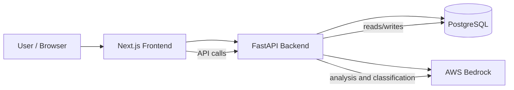

# RAVEN

RAVEN is a requirement assurance and traceability platform for regulated software projects. It addresses a common problem in safety- and compliance-focused development: requirements are imported, reviewed, and approved without a consistent way to assess their risk, evidence quality, control coverage, and testability.

The platform helps teams turn raw requirement text into structured, reviewable, evidence-backed decisions.

## Problem statement

In regulated environments, requirement quality and compliance are difficult to manage because teams often need to:

- ingest large numbers of requirement statements from CSV or JSON
- assess whether each requirement is clear, complete, and testable
- determine the associated risk and assurance level
- check whether the wording covers the required control areas
- maintain traceability between requirements, evidence, and changes
- generate the right testing artifacts when a requirement requires scripted validation

RAVEN provides a single workflow for these activities.

## What the system does

RAVEN supports the full requirement assurance lifecycle:

- requirement ingestion and persistence
- batch assessment of imported requirements
- evidence extraction and validation
- risk scoring and assurance decisioning
- compliance evaluation against named control areas
- traceability and change tracking
- generation of test scripts for scripted assurance outcomes

## Architecture



## Core components

- Frontend: Next.js web application used for ingestion, review, traceability, compliance, and assurance workflows.
- Backend: FastAPI service that stores requirements, orchestrates analysis, and exposes APIs for assessment and evaluation.
- Database: PostgreSQL for persistent requirement, assessment, and traceability data.
- AI layer: AWS Bedrock model calls used for evidence extraction, scoring, and compliance classification.

## Typical workflow

1. Import requirements from CSV or JSON files.
2. Run assessment for one or more requirements in batches.
3. Review evidence, risk score, and assurance decision.
4. Check compliance coverage for required control areas.
5. Inspect traceability and change history.
6. Generate a test script when the requirement requires scripted validation.

## Local setup

### Backend

```bash
cd backend
uv sync
uv run uvicorn app.main:app --reload
```

### Frontend

```bash
cd frontend
npm install
npm run dev
```

### Full stack with Docker

```bash
docker-compose up -d --build
```

The stack serves the app through the frontend and proxy configuration, with the backend and PostgreSQL running as supporting services.

## Intended outcome

RAVEN is designed to improve confidence in regulated software delivery by making requirement review, assurance, risk evaluation, and traceability visible, repeatable, and evidence-driven.
